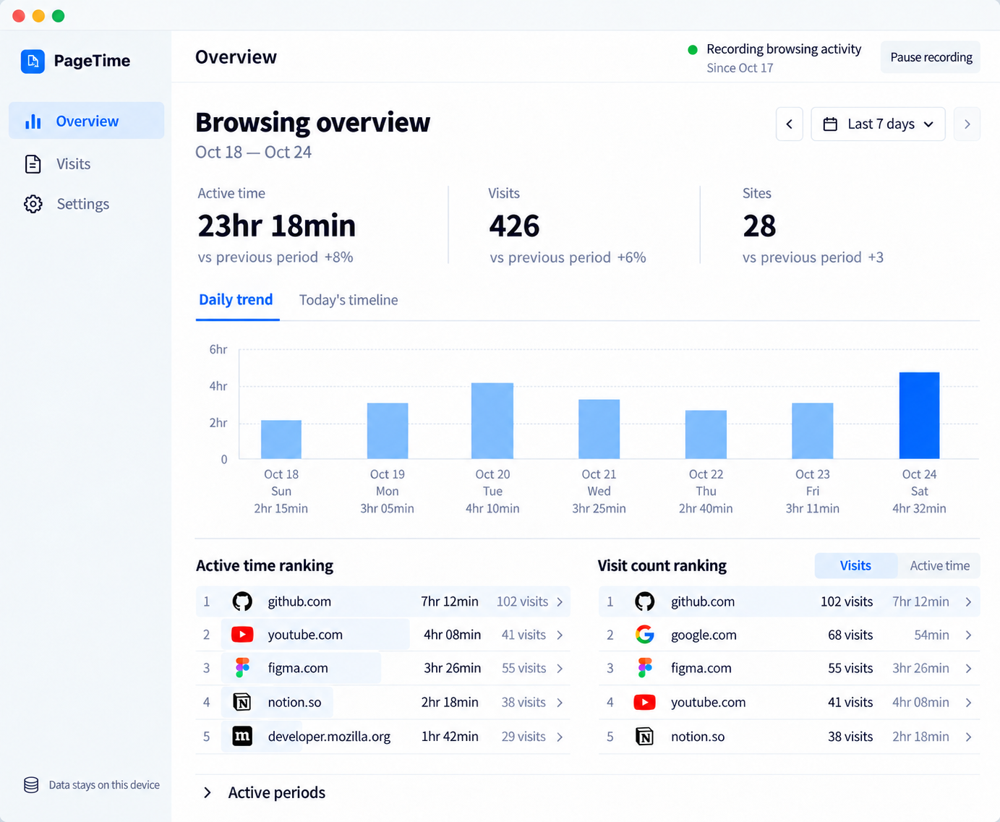

<p align="center"></p>

# PageTime

[English](README.md) · [简体中文](README.zh-CN.md)

See where your browsing time goes. PageTime records visits and active browsing time locally, with timelines, trends, and site rankings.

[Install from the Chrome Web Store](https://chromewebstore.google.com/detail/pagetime/mgkjfbmfjjinomnajdllibjbgjbdhipj) · [Website](https://pagetime.yukiniro.workers.dev/home.html)



*Product illustration with example data, not a capture of real browsing records. Your ledger starts empty.*

## Features

- Explore active time, visits, and site rankings for today, the last 7 or 30 days, or a custom date range.
- Inspect daily trends, single-day timelines, and individual site details.
- Check today's activity and top sites from the toolbar popup; pause or resume recording.
- Control recording with an allowlist or blocklist, export JSON / CSV, and restore a valid JSON backup.
- Choose from ten interface languages and system, light, or dark themes.

## Install and use

Install from the Chrome Web Store above. Click the toolbar icon for today's activity and select “Open dashboard” for full statistics. PageTime does not import browsing history from before installation.

For manual Chrome / Edge installation, download the Chrome ZIP from [GitHub Releases](https://github.com/Yukiniro/pagetime/releases/latest), extract it, enable Developer mode at `chrome://extensions` or `edge://extensions`, and choose “Load unpacked”. To update a sideloaded installation, replace the contents of the same folder and reload the extension to preserve its ID and local records.

## Privacy

No account or data upload. Records stay on your device and contain hostnames and activity, not full URLs, page titles, or page content. Site icons use bundled assets or the browser favicon cache without fetching remote icons.

The overview groups `www.`, `m.`, and `mobile.` prefixes while storage keeps each original hostname. See [Timing rules](docs/timing.md), [Privacy](PRIVACY.md), and [Permissions](docs/permissions.md) for measurement and retention details. Export a backup before deleting records or uninstalling.

## Development and contributions

Use Node.js 24 and npm:

```sh
npm ci
npm run dev:extension
npm run typecheck
npm run build:preview
npm test
npm run build
npm run verify-build
```

Run `npm run dev` for the empty dashboard at `/` and the website at `/home.html`. See the [development guide (Chinese)](docs/development.md), [contributor instructions](AGENTS.md), and [release guide (Chinese)](docs/releasing.md). Ordinary PRs require a Changeset; documentation-only changes may use an empty Changeset.

## License

[Apache-2.0](LICENSE) · Copyright 2026 Yukiniro. See [NOTICE](NOTICE) for notices.
