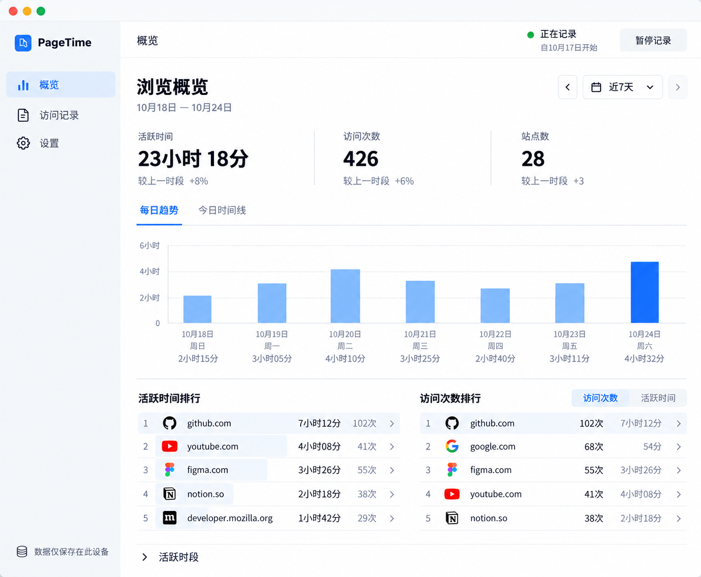

<p align="center"></p>

# PageTime

[English](README.md) · [简体中文](README.zh-CN.md)

看见浏览时间去了哪里。PageTime 在本机记录网页访问与活跃浏览时长，用时间线、趋势和站点排行呈现你的浏览足迹。

[从 Chrome 应用商店安装](https://chromewebstore.google.com/detail/pagetime/mgkjfbmfjjinomnajdllibjbgjbdhipj) · [官网](https://pagetime.yukiniro.workers.dev/home.html)



*产品示意图，包含示例数据，并非真实浏览记录截图。安装后的账本从空开始。*

## 功能

- 按今天、近 7 天、近 30 天或自定义日期查看活跃时间、访问次数和站点排行。
- 通过每日趋势、单日时间线和站点详情了解浏览活动。
- 工具栏小窗快速查看今日时长、常用站点，暂停或恢复记录。
- 用黑名单或白名单控制记录范围，导出 JSON / CSV，并从有效 JSON 备份恢复。
- 支持十种界面语言，主题跟随系统，也可选择浅色或深色。

## 安装与使用

推荐从上方 Chrome 应用商店安装。点击工具栏图标查看今日活动，选择“打开仪表盘”查看完整统计。安装前的浏览历史不会被导入。

手动安装 Chrome / Edge：从 [GitHub Releases](https://github.com/Yukiniro/pagetime/releases/latest) 下载 Chrome ZIP，解压后在 `chrome://extensions` 或 `edge://extensions` 开启开发者模式，选择“加载已解压的扩展程序”。更新侧载版本时覆盖原文件夹并重新加载，以保留扩展 ID 和本地记录。

## 隐私

无需账号，记录保存在本机，不上传。只保存主机名和活动记录，不保存完整网址、标题或页面正文。站点图标使用随包资源或浏览器 favicon 缓存，不请求远程图标。

概览合并 `www.`、`m.`、`mobile.` 前缀；底层仍保存原始主机名。详细计时和保留口径见 [计时规则](docs/timing.zh-CN.md)、[隐私政策](PRIVACY.zh-CN.md) 与 [权限说明](docs/permissions.zh-CN.md)。删除和卸载前请自行备份。

## 开发与贡献

使用 Node.js 24 和 npm：

```sh
npm ci
npm run dev:extension
npm run typecheck
npm run build:preview
npm test
npm run build
npm run verify-build
```

预览用 `npm run dev`：`/` 是空账本，`/home.html` 是官网。开发细节见 [开发指南](docs/development.md)，贡献约定见 [AGENTS.md](AGENTS.md)，版本流程见 [发布说明](docs/releasing.md)。普通 PR 需附 Changeset，纯文档可用空 Changeset。

## 许可证

[Apache-2.0](LICENSE) · Copyright 2026 Yukiniro。第三方声明见 [NOTICE](NOTICE)。
